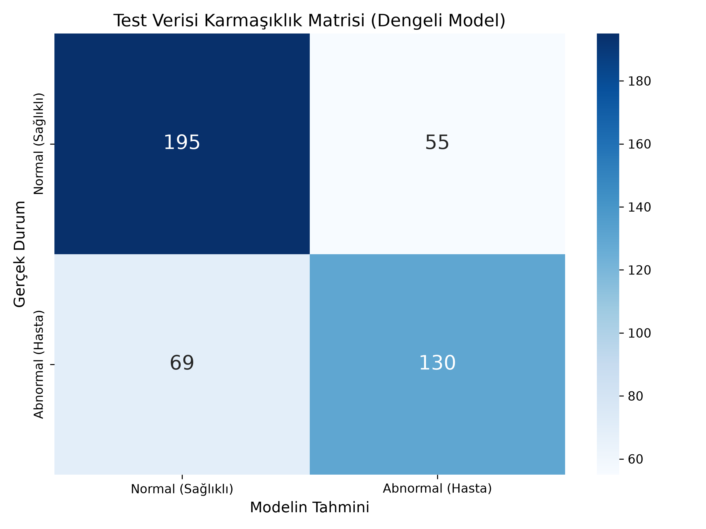
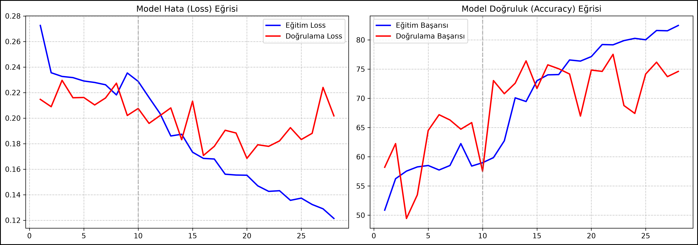

# AI-KneeRisk — Diz MR Görüntülerinden Dejenerasyon / Osteoartrit Risk Sınıflandırması

**TÜBİTAK 2209-A Üniversite Öğrencileri Araştırma Projeleri Destekleme Programı**
*Sporcularda Diz Dejenerasyonu ve Osteoartrit Risk Tahmininde Kullanılabilecek 3D MRI Tabanlı Derin Öğrenme Modeli*

Bu depo, 3B diz MR hacimlerinden (128×128×64, sagital kesitler) **Normal / Abnormal**
ayrımı yapan derin öğrenme modellerinin eğitim kodlarını, eğitilmiş ağırlıklarını,
akademik değerlendirme paketini ve kurulum gerektirmeyen Windows demo uygulamasını
(DizMR) içerir.

> ⚠️ **Sorumluluk Reddi:** Bu çalışma akademik/araştırma amaçlıdır. Model bir
> klinik tanı aracı değildir ve tıbbi karar için tek başına kullanılamaz.

---

## 🔑 Ana Model ve Test Sonuçları

Ana model: **ConvNeXt-Tiny (2.5D)** — ImageNet ön-eğitimli, Focal Loss + sınıf
dengeli örnekleme + merkez kırpma ile eğitilmiştir
(`kaydedilen_modeller/best_model_balanced_crop74.pth`).

**Bağımsız test seti** (n = 449: 250 normal, 199 abnormal) sonuçları:

| Metrik | Değer |
|---|---|
| Doğruluk (Accuracy) | **%72.38** |
| Duyarlılık (Sensitivity) | %65.33 |
| Özgüllük (Specificity) | %78.00 |
| ROC-AUC | **0.7966** |
| PR-AUC (Average Precision) | 0.7800 |
| Makro-F1 | 0.7179 |

Karmaşıklık matrisi: TN = 195, FP = 55, FN = 69, TP = 130.

<p align="center">
  
  
</p>

> **Yüksek Duyarlılık Modu:** Karar eşiği 0.50 → 0.43'e düşürüldüğünde duyarlılık
> %65.3 → **%81.9**'a çıkar (kaçan hasta 69 → 36), özgüllük %78 → %58 olur.
> Ayrıntı: [`Akademik_Arastirma_Paketi/dokumanlar/esik_analizi.md`](Akademik_Arastirma_Paketi/dokumanlar/esik_analizi.md)

### Model Karşılaştırması (Ablasyon)

| Model | Doğruluk | Makro-F1 | ROC-AUC | Duyarlılık | Özgüllük |
|---|---|---|---|---|---|
| **ConvNeXt-Tiny (Focal + Dengeli + Crop) — ANA** | **0.7238** | **0.7179** | **0.7966** | 0.6533 | 0.7800 |
| ConvNeXt-Tiny (Focal, önceki) | 0.6748 | 0.6748 | 0.7613 | 0.7789 | 0.5920 |
| EfficientNet-B0 (CrossEntropy) | 0.6592 | 0.6291 | 0.6997 | 0.4221 | 0.8480 |
| ResNet50 (Transfer, CrossEntropy) | 0.5969 | 0.5937 | 0.6585 | 0.7739 | 0.4560 |

Grafikler ve ham çıktılar: [`Akademik_Arastirma_Paketi/sonuclar/`](Akademik_Arastirma_Paketi/sonuclar/)
(ROC/PR eğrileri, karmaşıklık matrisi, model karşılaştırma, Grad-CAM örnekleri).

---

## ✅ Yapılan Doğrulama Analizleri

Tüm analizler `Akademik_Arastirma_Paketi/kaynak_kod/` scriptleriyle bağımsız test
seti üzerinde üretilmiştir; raporlar `dokumanlar/`, sayısal çıktılar `sonuclar/`
altındadır:

| Analiz | Sonuç özeti | Doküman / Çıktı |
|---|---|---|
| **Veri sızıntısı kontrolü** | Train/val/test arasında kimlik ve piksel düzeyinde örtüşme yok | [`sonuclar/veri_sizintisi_raporu.txt`](Akademik_Arastirma_Paketi/sonuclar/veri_sizintisi_raporu.txt) |
| **Overfitting / GAP analizi** | Genelleme boşluğu (train−test) 9.9 puan — hafif overfitting | [`dokumanlar/gap_analizi.md`](Akademik_Arastirma_Paketi/dokumanlar/gap_analizi.md) |
| **Karar eşiği analizi** | Eşik 0.43 ile yüksek duyarlılık modu | [`dokumanlar/esik_analizi.md`](Akademik_Arastirma_Paketi/dokumanlar/esik_analizi.md) |
| **Kesit derinliği analizi** | Merkezi kayan pencere, orta-3-kesit temeline göre daha iyi | [`dokumanlar/derinlik_analizi.md`](Akademik_Arastirma_Paketi/dokumanlar/derinlik_analizi.md) |
| **Hiperparametre analizi** | Ampirik tarama ile seçimlerin gerekçelendirilmesi | [`dokumanlar/hiperparametre_analizi.md`](Akademik_Arastirma_Paketi/dokumanlar/hiperparametre_analizi.md) |
| **Mimari ablasyonu** | ConvNeXt-Tiny + Focal + dengeleme en iyi kombinasyon | [`dokumanlar/ablasyon_analizi.md`](Akademik_Arastirma_Paketi/dokumanlar/ablasyon_analizi.md) |
| **Açıklanabilirlik (Grad-CAM)** | Modelin odaklandığı bölgelerin ısı haritaları | [`sonuclar/gradcam_ornekleri/`](Akademik_Arastirma_Paketi/sonuclar/gradcam_ornekleri/) |

Metodoloji ve model kartı:
[`dokumanlar/metodoloji.md`](Akademik_Arastirma_Paketi/dokumanlar/metodoloji.md) ·
[`dokumanlar/model_karti.md`](Akademik_Arastirma_Paketi/dokumanlar/model_karti.md)

---

## 📁 Depo Yapısı

```
├── README.md                                  # Bu dosya
├── LICENSE                                    # MIT
├── convext-tiny-focalloss-centercrop-001.py   # Ana model eğitim scripti
├── convext-tiny-focalloss-centercrop-001t.py  # Ana model test scripti
├── Monai.py / Monai_Test.py                   # MONAI DenseNet3D deneyleri
├── OverFitting_DataLeakage.md                 # Overfitting/sızıntı ön notları
├── ogrenme_egrileri_balanced.png              # Eğitim/validasyon eğrileri
├── test_karmasiklik_matrisi_balanced.png      # Test karmaşıklık matrisi
├── kaydedilen_modeller/                       # Eğitilmiş ağırlıklar (Git LFS)
└── Akademik_Arastirma_Paketi/
    ├── README.md                              # Paketin ayrıntılı kılavuzu
    ├── requirements.txt
    ├── kaynak_kod/                            # Değerlendirme + analiz + arayüz scriptleri
    ├── dokumanlar/                            # Metodoloji, model kartı, analiz raporları
    ├── sonuclar/                              # Metrikler, grafikler, Grad-CAM çıktıları
    └── dagitim_exe/
        ├── launcher.py / DizMR.spec / derle.ps1  # PyInstaller derleme kaynakları
        └── KULLANIM.md                        # Uygulama kullanım kılavuzu
```

> Kurulumsuz Windows uygulaması (`DizMR_Windows_x64.zip`, ~330 MB) depoda değil,
> [**Releases**](../../releases) sayfasında yayımlanır.

### Kayıtlı Modeller (`kaydedilen_modeller/`, Git LFS)

| Dosya | Mimari | Boyut |
|---|---|---|
| `best_model_balanced_crop74.pth` | **ConvNeXt-Tiny 2.5D (ANA MODEL)** | 107 MB |
| `best_convnext_tiny_2.5d_focal.pth` | ConvNeXt-Tiny 2.5D (önceki sürüm) | 107 MB |
| `best_r2plus1d.pth` | R(2+1)D — 3B video mimarisi | 121 MB |
| `resnet50_2.5d_transfer_learning.pth` | ResNet50 2.5D transfer öğrenme | 92 MB |
| `best_monai_densenet3d.pth` | MONAI DenseNet121 3B | 44 MB |
| `efficientnet_b0_best_model.pth` | EfficientNet-B0 | 17 MB |

> **Veri notu:** Eğitim/test verisi (`data/`, ~8 GB MR hacmi) boyutu nedeniyle
> depoya dahil edilmemiştir.

---

## ⚙️ Kurulum

Bu depo büyük dosyalar için **Git LFS** kullanır — klonlamadan önce
[git-lfs](https://git-lfs.com) kurulu olmalıdır:

```bash
git lfs install
git clone https://github.com/berenrusatci/AI-KneeRisk-Sporcularda-Diz-Dejenerasyonu-ve-Osteoartrit-Risk-Tahmininde-Kullan-labilecek-3D-MRI.git
```

Python ortamı (Python 3.12 önerilir):

```powershell
python -m venv .venv312
.\.venv312\Scripts\Activate.ps1
pip install -r Akademik_Arastirma_Paketi\requirements.txt
```

Değerlendirme ve analiz scriptlerinin çalıştırılması için
[`Akademik_Arastirma_Paketi/README.md`](Akademik_Arastirma_Paketi/README.md)
dosyasına bakın.

## 🖥️ DizMR — Kurulumsuz Windows Uygulaması

Python kurmadan modeli denemek için:

1. [**Releases**](../../releases) sayfasından `DizMR_Windows_x64.zip` (~330 MB)
   dosyasını indirin ve bir klasöre çıkarın.
2. `DizMR\DizMR.exe`'ye çift tıklayın; arayüz 10–30 sn içinde tarayıcıda açılır
   (http://localhost:8501).
3. Ayrıntılar ve sorun giderme:
   [`dagitim_exe/KULLANIM.md`](Akademik_Arastirma_Paketi/dagitim_exe/KULLANIM.md)

Uygulama, `derle.ps1` + `DizMR.spec` ile PyInstaller kullanılarak yeniden
derlenebilir (derleme sonrası zip'in de güncellenmesi gerekir).

## 📄 Lisans

Bu proje [MIT Lisansı](LICENSE) ile lisanslanmıştır.
